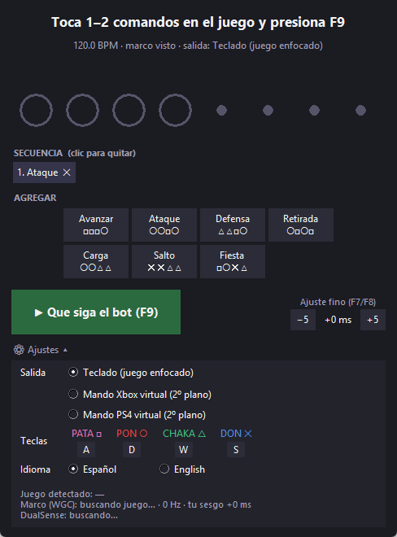

<div align="center">

# 🥁 PataAuto

**Auto-tambor para Patapon 3 DxD (recomp de PC).**
Toca un par de comandos, presiona **F9** y el bot sigue el ritmo por ti, sincronizado con el marco del juego.

**Auto-drummer for Patapon 3 DxD (PC recomp).**
Play a couple of commands, press **F9** and the bot keeps the rhythm for you, synced to the game's border.

### [⬇️ Descargar / Download](../../releases/latest)



[Español](#español) · [English](#english)

</div>

---

## Español

### Qué hace
- **Relevo con F9:** tocas 1 o 2 comandos a mano, presionas F9 y el bot sigue en el siguiente compás, sin romper el combo ni la fever. Otro F9 y vuelves a tocar tú.
- **Se sincroniza solo:** lee el marco de la pantalla, que parpadea en cada beat, y corrige el tempo y la fase en cada compás. No hay que calibrar nada.
- **Funciona con el juego tapado:** puedes poner otras ventanas encima y seguir usando la PC mientras farmeas (no lo minimices).
- **Secuencias:** arma una lista de comandos (Ataque, Avanzar, Avanzar…) y el bot la repite en bucle.
- **Cronómetro:** muestra cuánto lleva farmeando el bot y cuánto duró la última sesión.
- Interfaz en **español e inglés**.

### Instalación
1. Descarga `PataAuto-Setup-x.y.z.exe` desde [Releases](../../releases/latest) y ejecútalo.
2. Deja marcadas las opciones del instalador:
   - **ViGEmBus**: el driver del mando virtual (solo aparece si no lo tienes).
   - **Leer el mando en 2º plano**: activa `SDL_JOYSTICK_ALLOW_BACKGROUND_EVENTS=1` para que el juego reciba el mando aunque no tenga el foco.
3. Si el juego estaba abierto, **reinícialo**.

> Windows SmartScreen puede decir "editor desconocido" porque el instalador no está firmado: **Más información → Ejecutar de todas formas**. Si tu antivirus lo marca, es porque la app escucha F9 en todo el sistema y simula un mando. El código completo está en este repo.

### Uso
1. Abre PataAuto **antes** de entrar a la misión: el mando virtual se conecta al abrirla.
2. Juega en **modo ventana** o **pantalla completa sin bordes** (no exclusiva).
3. En la app, arma tu **secuencia** con los botones de "Agregar".
4. En el juego, toca 1 o 2 comandos a tiempo y presiona **F9**. El bot sigue en el siguiente compás.
5. Cuando aparezca **"✓ corrigiendo con el marco"**, ya puedes tapar la ventana del juego y hacer otra cosa.
6. **F9** otra vez para retomar el control.

| Tecla | Acción |
|---|---|
| **F9** | El bot toma / devuelve el control |
| **F7 / F8** | Ajuste fino: mueve los golpes del bot −5 / +5 ms (casi nunca hace falta) |

### Ajustes (⚙)
- **Salida**
  - *Mando Xbox virtual* (recomendado): funciona con el juego en segundo plano.
  - *Mando PS4 virtual*: igual, con botones de PlayStation.
  - *Teclado*: solo pulsa cuando el juego tiene el foco.
- **Teclas**: tus teclas de Pata / Pon / Chaka / Don si usas la salida de teclado.
- **Idioma**: Español / English.

### Problemas comunes
- **"marco ✗" o "juego no encontrado"**: el juego está minimizado o en pantalla completa exclusiva.
- **El juego no responde al mando virtual en 2º plano**: reinicia el juego después de instalar. Si tienes **Steam** abierto, desactiva Steam Input para mandos de Xbox/PlayStation.
- **El bot va en tiempo pero los golpes no salen "perfectos"**: ajusta con F7/F8 de 5 en 5 ms.
- **"Llegaste tarde al compás"**: presiona F9 justo después de terminar tu comando, mientras los Patapon responden.

### Compilar desde el código
Requiere Python 3.11+ (64 bits) e [Inno Setup 7](https://jrsoftware.org/isinfo.php).
```powershell
pip install pynput psutil pygame vgamepad numpy windows-capture pyinstaller
python pataauto.py                 # correr directo
.\installer\build.ps1               # generar installer\out\PataAuto-Setup-x.y.z.exe
```

---

## English

### What it does
- **F9 relay:** play 1–2 commands yourself, press F9 and the bot takes over on the next measure, without breaking your combo or fever. Press F9 again to take back control.
- **Self-syncing:** it reads the on-screen border, which flashes on every beat, and corrects tempo and phase every measure. No calibration needed.
- **Works with the game covered:** you can put other windows on top and keep using your PC while farming (just don't minimize it).
- **Sequences:** build a list of commands (Attack, March, March…) and the bot loops it.
- **Timer:** shows how long the bot has been farming and how long the last session lasted.
- UI in **English and Spanish**.

### Install
1. Download `PataAuto-Setup-x.y.z.exe` from [Releases](../../releases/latest) and run it.
2. Keep the installer options checked:
   - **ViGEmBus**: the virtual gamepad driver (only shown if you don't have it).
   - **Read the gamepad in the background**: sets `SDL_JOYSTICK_ALLOW_BACKGROUND_EVENTS=1` so the game accepts the gamepad without focus.
3. If the game was open, **restart it**.

> Windows SmartScreen may say "unknown publisher" because the installer isn't signed: **More info → Run anyway**. If your antivirus flags it, that's because the app listens for F9 system-wide and emulates a gamepad. The full source is in this repo.

### Usage
1. Open PataAuto **before** starting the mission: the virtual gamepad connects when the app opens.
2. Play in **windowed** or **borderless fullscreen** mode (not exclusive fullscreen).
3. In the app, build your **sequence** with the "Add" buttons.
4. In the game, play 1–2 commands on beat and press **F9**. The bot continues on the next measure.
5. Once it shows **"✓ synced to the border"**, you can cover the game window and do something else.
6. Press **F9** again to take back control.

| Key | Action |
|---|---|
| **F9** | Bot takes over / hands back control |
| **F7 / F8** | Fine tune: shifts the bot's hits −5 / +5 ms (rarely needed) |

### Settings (⚙)
- **Output**
  - *Virtual Xbox pad* (recommended): works with the game in the background.
  - *Virtual PS4 pad*: same, with PlayStation buttons.
  - *Keyboard*: only presses while the game is focused.
- **Keys**: your Pata / Pon / Chaka / Don keys if you use keyboard output.
- **Language**: Español / English.

### Troubleshooting
- **"border ✗" or "game not found"**: the game is minimized or in exclusive fullscreen.
- **The game ignores the virtual pad in the background**: restart the game after installing. If **Steam** is open, disable Steam Input for Xbox/PlayStation controllers.
- **The bot is on beat but hits aren't "perfect"**: adjust with F7/F8 in 5 ms steps.
- **"Late for the measure"**: press F9 right after finishing your command, while the Patapons respond.

### Build from source
Requires Python 3.11+ (64-bit) and [Inno Setup 7](https://jrsoftware.org/isinfo.php).
```powershell
pip install pynput psutil pygame vgamepad numpy windows-capture pyinstaller
python pataauto.py                 # run directly
.\installer\build.ps1              # build installer\out\PataAuto-Setup-x.y.z.exe
```

---

<sub>Proyecto de fans, sin relación con Sony Interactive Entertainment. Patapon es marca de sus respectivos dueños. · Fan project, not affiliated with Sony Interactive Entertainment. Patapon is a trademark of its respective owners.</sub>
